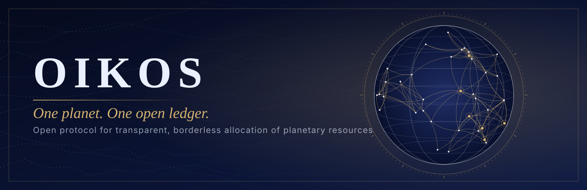

  

  <a href="README.md">English</a> · <b>Русский</b>

# OIKOS Protocol

**Глобальная децентрализованная система автоматического распределения ресурсов планеты на базе открытого ИИ.**

OIKOS (греч. *oikos* — «дом, хозяйство», корень слова «экономика») — открытый протокол для учёта,
моделирования и распределения ресурсов единой планеты: продовольствия, воды, энергии, материалов,
лекарств и вычислительных мощностей. Он задуман так, чтобы не зависеть от политических границ,
бюрократических «бутылочных горлышек» и патентных барьеров на жизненно важные лекарства.

> **Статус:** концепция и запрос на обсуждение (RFC). Ничего здесь не развёрнуто в работе,
> и ничто не должно приниматься за готовую систему.

## Зачем

- Ресурсы производятся в одном месте, а нужны в другом, но данные, которые их связывают, разрозненны и закрыты.
- Решения о распределении принимаются в непрозрачных процессах, которые не могут проверить те, кого они касаются.
- Доступ к жизненно важным знаниям, включая лекарства, ограничен патентами, а не возможностями производства.

OIKOS задаёт один вопрос: **что, если распределение будет прозрачным, вычислимым и проверяемым любым человеком?**

## Принципы

| Принцип | Смысл |
|---|---|
| **Открытость по умолчанию** | Код, модели, веса, схемы данных и журналы решений публичны. |
| **Проверяемость** | Любое распределение воспроизводимо из публичных входных данных. Никаких чёрных ящиков. |
| **Децентрализация** | Ни один оператор, юрисдикция или ключ не может контролировать или отключить сеть. |
| **Без границ** | Распределение считается по потребности и возможностям, а не по административной географии. |
| **Суверенитет человека** | ИИ предлагает; люди могут проверять, оспаривать и отменять решения через открытое управление. |
| **Не навреди** | Жёсткие ограничения и проверка безопасности предшествуют любым возможностям. |

## Архитектура

1. **Sensing** — приём открытых и подтверждённых данных о производстве, запасах, спросе и логистике.
2. **Resource Graph** — общая версионируемая модель потоков ресурсов планеты.
3. **Ledger** — защищённый от подделки журнал входных данных, решений и результатов.
4. **Allocation** — открытые модели, предлагающие распределение при явных опубликованных целях и ограничениях.
5. **Governance** — слой, где люди задают цели, проверяют решения и отзывают полномочия.

## Дорожная карта

- [ ] **Фаза 0 — Хартия.** Манифест, модель угроз, черновик управления, этическая экспертиза.
- [ ] **Фаза 1 — Resource Graph.** Открытая схема и агрегатор публичных данных.
- [ ] **Фаза 2 — Симулятор.** Модели распределения в песочнице, проверка на исторических данных.
- [ ] **Фаза 3 — Ledger.** Эталонная реализация проверяемого журнала решений.
- [ ] **Фаза 4 — Пилоты.** Добровольные локальные внедрения под контролем людей.
- [ ] **Фаза 5 — Федерация.** Взаимодействие независимых узлов.

## Нерешённые проблемы

- **Легитимность.** Кто задаёт целевую функцию и как сделать этот выбор справедливым?
- **Стимулы.** Производители должны сохранять мотивацию производить, и протокол обязан это моделировать.
- **Целостность данных.** Ложные входные данные портят все последующие решения.
- **Противники.** Столь значимая система становится мишенью; безопасность — первоочередная задача.
- **Безопасность ИИ.** Автономность должна быть ограничена; человеческое вмешательство должно работать всегда.
- **Лекарства и патенты.** Это вопрос права, качества, безопасности и финансирования исследований, а не только кода.
- **Переход.** Сегодня существуют реальные институты, законы и люди; любой путь вперёд должен с этим считаться.

## Участие

Нужны экономисты, инженеры систем, логисты, криптографы, ML-исследователи, специалисты по
общественному здравоохранению, юристы и критики. Создайте issue с меткой `RFC`, чтобы предложить
или оспорить что угодно, включая саму идею.

## Лицензия

AGPL-3.0 для кода. CC BY-SA 4.0 для документации и графики.
